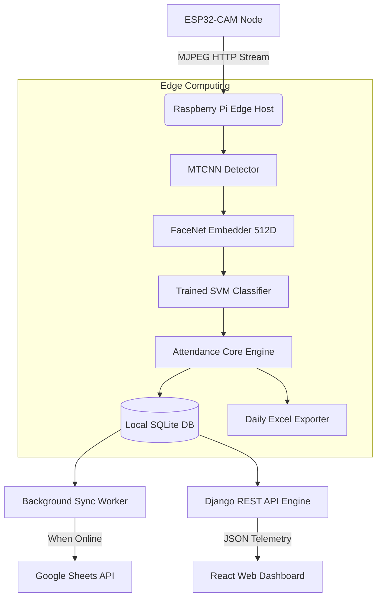

# 🎓 EdgeAI Smart Attendance System
> An Offline-First, Real-Time Edge Facial Recognition Attendance System powered by **ESP32-CAM**, **Raspberry Pi**, **FaceNet + SVM**, **Django REST Framework**, and **React**.

[](https://www.python.org/)
[](https://reactjs.org/)
[](https://www.djangoproject.com/)
[](https://opencv.org/)
[](https://www.raspberrypi.com/)
[](https://opensource.org/licenses/MIT)

---

## 📌 Overview

The **EdgeAI Smart Attendance System** is an end-to-end intelligent edge IoT solution designed for bandwidth-constrained, offline, and remote educational or enterprise environments. By decoupling video acquisition (**ESP32-CAM**) from edge inference (**Raspberry Pi**), the system performs real-time face detection (MTCNN), 512-dimensional embedding extraction (FaceNet), and rapid identification (SVM) locally without relying on continuous internet connectivity.

When network connectivity is established, local logs seamlessly synchronize with Google Sheets in the background while updating real-time web telemetry over Django REST Framework and a React dashboard.

---

## 🚀 Key Features

* **⚡ Offline-First Edge Inference:** Real-time facial inference loop (~110ms - 130ms/frame on Raspberry Pi) using MTCNN and FaceNet + SVM.
* **📷 Hardware Decoupling:** Standalone ESP32-CAM node serving low-latency MJPEG video streams over local Wi-Fi / AP.
* **🛡️ Duplicate Entry Guard:** Intelligent algorithmic deduplication preventing redundant attendance logging within the same calendar date.
* **📊 Dual-Mode Storage & Export:** Automated local persistence using SQLite alongside automated daily Excel (`.xlsx`) sheet generation.
* **☁️ Resilient Cloud Sync:** Non-blocking background worker thread that monitors internet status and auto-syncs pending records to Google Sheets.
* **🖥️ Modern Full-Stack Telemetry:** 
  * Headless OpenCV inference worker.
  * REST API powered by Django REST Framework.
  * Responsive real-time monitoring dashboard built with React (Vite) and Tailwind CSS.
* **🗣️ Voice Engine Ready:** Offline voice assistant module integrated via Vosk Speech Recognition and TTS.

---

## 🏗️ System Architecture



---

## 📂 Repository Structure

```text
smart_attendance_system/
├── ai_engine/                    # Machine Learning & Computer Vision
│   ├── models/                   # Serialized SVM Models, Encoders & Weights
│   ├── face_recognizer.py        # MTCNN + FaceNet + SVM Pipeline
│   └── camera_stream.py          # Low-latency MJPEG Stream Consumer
├── backend/                      # Django REST API
│   ├── manage.py
│   ├── attendance_api/           # Models, Serializers, ViewSets
│   └── core_settings/            # Django Settings, ASGI/WSGI Configurations
├── core/                         # Asynchronous Workers & Business Logic
│   ├── local_storage.py          # SQLite Operations & Auto Excel Export
│   ├── cloud_sync.py             # Non-blocking Threaded Google Sheets Sync
│   └── voice_control.py          # Offline Vosk / Myanmar Speech Assistant
├── data/
│   ├── captured_faces/           # Verified attendance face snapshots
│   ├── exports/                  # Offline Generated .xlsx records
│   └── attendance.db             # Local SQLite database
├── frontend/                     # React Single Page Dashboard (Vite + Tailwind)
├── logs/                         # Execution logs & audit traces
├── run_system.py                 # Core Headless Edge Processing Runner
├── web_stream_system.py          # Optional Flask Stream Multi-caster
├── requirements.txt              # Core Python Dependencies
└── README.md
```

---

## 🛠️ Hardware & Tech Stack

| Domain | Technologies |
|---|---|
| **Edge Hardware** | Raspberry Pi 4 / 5 (Raspbian OS), ESP32-CAM (OV3660 / OV2640) |
| **Machine Learning** | MTCNN, FaceNet (`keras-facenet`), Scikit-learn (SVM Classifier) |
| **Computer Vision** | OpenCV (headless) |
| **Backend & API** | Python 3.11+, Django 5+, Django REST Framework, SQLite |
| **Frontend** | React 18, Vite, Tailwind CSS |
| **Cloud Integration**| Google Sheets API (`gspread`), OAuth2 |

---

## ⚙️ Installation & Quickstart

### 1. Clone the Repository
```bash
git clone https://github.com/SalaiJiChanWook/smart_attendance_system.git
cd smart_attendance_system
```

### 2. Environment Setup (Python Edge Engine)
```bash
python3 -m venv venv
source venv/bin/activate
pip install -r requirements.txt
```

### 3. Configure Environment Variables
Create a `.env` file in the project root:
```ini
ESP32_CAM_URL=http://10.199.48.130
DB_PATH=data/attendance.db
MODEL_PATH=ai_engine/models/svm_model_160x160.pkl
SHEET_NAME=Student_Attendance
```

---

## 🏃 Running the System

For full system execution, initialize the components across dedicated terminals:

#### Terminal 1: Edge AI Processing Engine
```bash
python run_system.py
```

#### Terminal 2: Django REST Backend Server
```bash
cd backend
python manage.py runserver 0.0.0.0:8000
```

#### Terminal 3: React Live Dashboard
```bash
cd frontend
npm install
npm run dev -- --host
```

Access the web monitoring dashboard at `http://<EDGE_DEVICE_IP>:5173`.

---

## 📈 Performance & Benchmark Metrics

* **Detection Latency:** $\approx 110\text{ms} - 130\text{ms}$ per frame (ARM64 Quad-Core).
* **Recognition Accuracy:** Over **$96\%$ verification rate** on trained subject embeddings using linear SVM.
* **Network Independence:** Zero loss of capture events during complete Wi-Fi / WAN disconnection.

---

## 👨‍💻 Author

**Salai Lun Hlyan Paung**  
* GitHub: [@SalaiJiChanWook](https://github.com/SalaiJiChanWook)  
* Showcase Profile: [SalaiJiChanWook Portfolio](https://github.com/SalaiJiChanWook/SalaiJiChanWook)

---

## 📄 License
This project is licensed under the MIT License - see the [LICENSE](LICENSE) file for details.